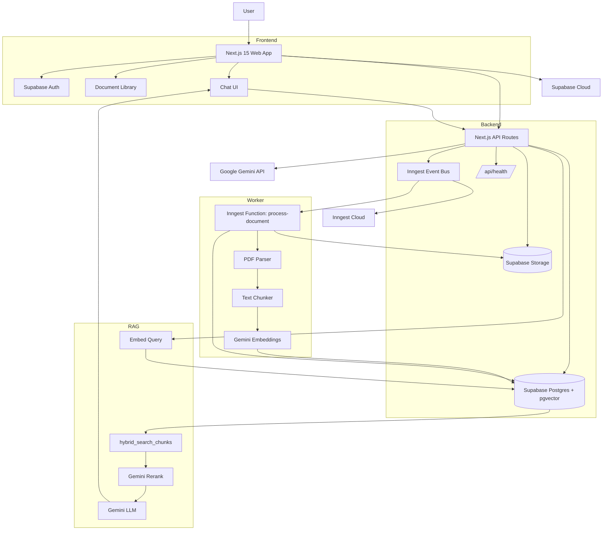
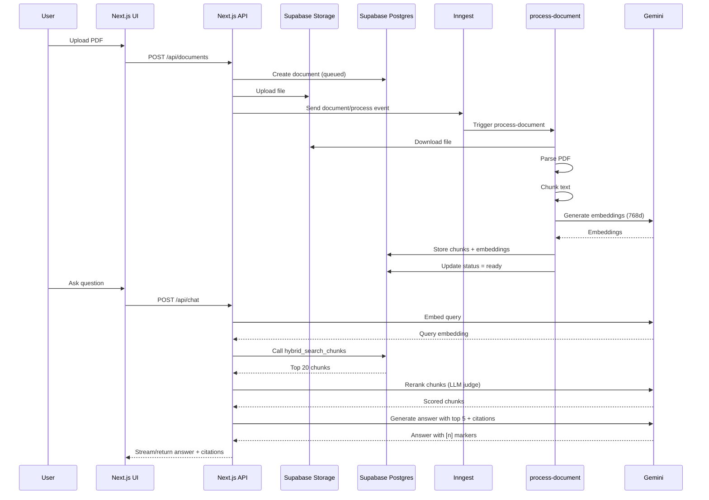
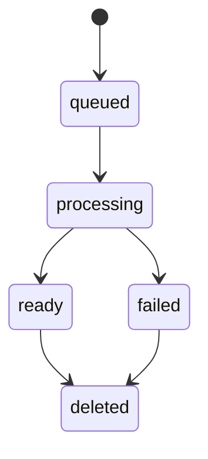

Below is the complete `README.md` in professional, technical tone, formatted for direct GitHub editing. It highlights architecture, engineering decisions, measurable evaluation, and deployment details in a way that is readable for both engineers and recruiters.

```markdown
# DocMind

**DocMind** is a full-stack, AI-powered document intelligence platform that enables users to upload PDFs, process them asynchronously, and query their contents through Retrieval-Augmented Generation (RAG).
`**Live Demo:** [https://your-app.vercel.app](https://your-app.vercel.app)`

Built with **Next.js 15**, **Supabase**, **Inngest**, **Google Gemini**, and deployed on **Vercel**.

[](https://nextjs.org/)
[](https://www.typescriptlang.org/)
[](https://supabase.com/)
[](https://www.inngest.com/)
[](https://ai.google.dev/)
[](https://vercel.com/)

---

## Overview

I built DocMind to demonstrate how modern RAG pipelines can be optimized beyond simple vector search. The application features hybrid retrieval, LLM-based reranking, and inline citations, all deployed serverlessly with durable background jobs.

### Technical Highlights

- **Hybrid Retrieval**: Combined pgvector cosine similarity with PostgreSQL full-text search using Reciprocal Rank Fusion (RRF) to improve recall on both semantic and keyword-heavy queries.
- **LLM Reranking**: Used Gemini Flash as an LLM judge to rescore the top 20 hybrid candidates and select the top 5 for generation, fixing the "correct answer buried at rank 12" problem.
- **Inline Citations**: Mapped model-generated `[n]` markers to source chunks, persisted as JSONB, and rendered as interactive citation chips.
- **Evaluation Harness**: Built a general-purpose harness that auto-generates Q&A pairs from any uploaded PDF and benchmarks vector-only retrieval against the hybrid+rerank pipeline using an LLM judge.
- **Serverless Deployment**: Deployed on Vercel with Inngest for durable background jobs and Supabase for auth, storage, and vector database.

---

## Features

- **Authentication** with Supabase Auth
- **PDF upload** and document library
- **Background processing** with Inngest
- **Automatic chunking** and text extraction
- **Gemini embeddings** stored in Supabase Postgres with `pgvector`
- **Hybrid search** (vector + keyword with Reciprocal Rank Fusion)
- **Reranking** with Gemini as an LLM judge
- **RAG chat** with document context
- **Inline citations** with clickable `[n]` chips and popovers
- **Document status tracking**: `queued`, `processing`, `ready`, `failed`, `deleted`
- **Health check endpoint** at `/api/health`
- **Testing** with Vitest and Playwright
- **Evaluation harness** for reproducible RAG benchmarking

---

## Architecture



---

## RAG Pipeline



---

## Document Status State



---

## Tech Stack

| Layer | Technology |
|---|---|
| Framework | Next.js 15 (App Router) |
| Language | TypeScript |
| UI | React, Tailwind CSS, Radix UI, Lucide |
| Auth & DB | Supabase Auth, Supabase Postgres |
| Vector Search | `pgvector`, `hybrid_search_chunks` (RRF) |
| Reranking | Gemini Flash (LLM judge) |
| Citations | Inline `[n]` chips with popovers |
| Storage | Supabase Storage |
| Background Jobs | Inngest |
| AI / Embeddings | Google Gemini |
| Testing | Vitest, Playwright, Testing Library |
| Evaluation | Custom harness (`npm run eval`) |
| Deployment | Vercel |

---

## Project Structure

```text
DocMind/
├── src/
│   ├── app/
│   │   ├── (auth)/
│   │   │   ├── login/
│   │   │   ├── signup/
│   │   │   ├── reset-password/
│   │   │   └── verify-email/
│   │   ├── (dashboard)/
│   │   │   ├── chat/
│   │   │   ├── dashboard/
│   │   │   ├── library/
│   │   │   └── settings/
│   │   ├── (marketing)/
│   │   ├── api/
│   │   │   ├── auth/callback/
│   │   │   ├── chat/
│   │   │   ├── conversations/
│   │   │   ├── documents/
│   │   │   ├── health/
│   │   │   └── inngest/
│   │   ├── globals.css
│   │   ├── layout.tsx
│   │   └── providers.tsx
│   ├── components/
│   │   ├── chat/
│   │   │   ├── citation-chip.tsx
│   │   │   └── message-content.tsx
│   │   ├── documents/
│   │   └── ui/
│   ├── hooks/
│   ├── inngest/
│   │   ├── client.ts
│   │   └── functions/process-document.ts
│   ├── lib/
│   │   ├── auth/
│   │   ├── documents/
│   │   ├── embeddings/
│   │   ├── errors/
│   │   ├── observability/
│   │   ├── rag/
│   │   │   ├── citations.ts
│   │   │   ├── prompt.ts
│   │   │   ├── rerank.ts
│   │   │   └── retrieval.ts
│   │   ├── rate-limit/
│   │   ├── storage/
│   │   ├── supabase/
│   │   ├── env.ts
│   │   └── utils.ts
│   ├── server/actions/
│   ├── types/
│   └── middleware.ts
├── supabase/migrations/
├── tests/
│   ├── rag-eval/
│   │   ├── run-eval.ts
│   │   ├── questions.json (optional)
│   │   └── results.json (generated)
│   ├── setup.ts
│   └── unit/
├── .env.example
├── .gitignore
├── next.config.ts
├── package.json
├── playwright.config.ts
├── postcss.config.mjs
├── tailwind.config.ts
├── tsconfig.json
└── vitest.config.ts
```

> `.env.local` is intentionally excluded and should never be committed.

---

## Getting Started

### Prerequisites

- Node.js 20+
- npm or pnpm
- Supabase project
- Google Gemini API key
- Inngest account (or local Inngest Dev Server)
- Vercel account for deployment

### 1. Clone and Install

```bash
git clone https://github.com/subhra015/DocMind.git
cd DocMind
npm install
```

### 2. Configure Environment Variables

Copy `.env.example` to `.env.local`:

```bash
cp .env.example .env.local
```

On Windows PowerShell:

```powershell
copy .env.example .env.local
```

Fill in the values described in the table below.

### 3. Run Locally

```bash
npm run dev
```

Start the Inngest Dev Server in a second terminal:

```bash
npx inngest-cli dev -u http://localhost:3000/api/inngest
```

Open [http://localhost:3000](http://localhost:3000).

---

## Environment Variables

| Variable | Required | Scope | Description |
|---|---:|---|---|
| `NEXT_PUBLIC_SUPABASE_URL` | Yes | Public | Supabase project URL |
| `NEXT_PUBLIC_SUPABASE_ANON_KEY` | Yes | Public | Supabase anonymous key |
| `SUPABASE_SERVICE_ROLE_KEY` | Yes | Server only | Supabase service role key. Never expose to client |
| `GEMINI_API_KEY` | Yes | Server only | Google Gemini API key |
| `INNGEST_EVENT_KEY` | Yes | Server | Inngest event key |
| `INNGEST_SIGNING_KEY` | Yes | Server | Inngest signing key for production |
| `INNGEST_APP_ID` | Yes | Server | Inngest app ID, e.g. `docmind` |
| `NEXT_PUBLIC_APP_URL` | Yes | Public | App URL, e.g. `http://localhost:3000` or your Vercel URL |

> Do not set `PORT` on Vercel. Vercel manages the port automatically.

---

## Database Setup

### Enable pgvector

```sql
create schema if not exists extensions;
create extension if not exists vector with schema extensions;
```

### Configure Embedding Dimension

Gemini embeddings are 768-dimensional.

```sql
alter table public.chunks
alter column embedding type extensions.vector(768);
```

### Document Status Constraint

```sql
alter table public.documents
drop constraint if exists documents_status_check;

alter table public.documents
add constraint documents_status_check
check (status in ('queued', 'processing', 'ready', 'failed', 'deleted'));
```

### Required Document Columns

```sql
alter table public.documents add column if not exists checksum text;
alter table public.documents add column if not exists original_filename text;
alter table public.documents add column if not exists mime_type text;
alter table public.documents add column if not exists processing_progress integer default 0;
```

### Citations and Token Usage

```sql
alter table public.messages
add column if not exists citations jsonb default '[]';

alter table public.messages
add column if not exists token_usage jsonb;
```

### Full-Text Search Column and Index

```sql
alter table public.chunks
add column if not exists content_tsv tsvector
generated always as (to_tsvector('english', content)) stored;

create index if not exists chunks_content_tsv_idx
on public.chunks using gin (content_tsv);
```

### Hybrid Search Function

```sql
create or replace function public.hybrid_search_chunks(
  query_embedding extensions.vector(768),
  query_text text,
  requested_user_id uuid,
  requested_document_id uuid default null,
  match_count int default 20,
  rrf_k int default 60
)
returns table (
  id uuid,
  document_id uuid,
  content text,
  chunk_index int,
  page_number int,
  similarity float,
  keyword_rank int,
  vector_rank int,
  rrf_score float
)
language plpgsql
as $$
begin
  return query
  with vector_results as (
    select
      c.id,
      c.document_id,
      c.content,
      c.chunk_index,
      c.page_number,
      1 - (c.embedding <=> query_embedding) as similarity,
      row_number() over (order by c.embedding <=> query_embedding) as vector_rank
    from public.chunks c
    where c.user_id = requested_user_id
      and (requested_document_id is null or c.document_id = requested_document_id)
    order by c.embedding <=> query_embedding
    limit match_count
  ),
  keyword_results as (
    select
      c.id,
      c.document_id,
      c.content,
      c.chunk_index,
      c.page_number,
      ts_rank(c.content_tsv, plainto_tsquery('english', query_text)) as keyword_score,
      row_number() over (order by ts_rank(c.content_tsv, plainto_tsquery('english', query_text)) desc) as keyword_rank
    from public.chunks c
    where c.user_id = requested_user_id
      and (requested_document_id is null or c.document_id = requested_document_id)
      and c.content_tsv @@ plainto_tsquery('english', query_text)
    order by keyword_score desc
    limit match_count
  )
  select
    coalesce(v.id, k.id) as id,
    coalesce(v.document_id, k.document_id) as document_id,
    coalesce(v.content, k.content) as content,
    coalesce(v.chunk_index, k.chunk_index) as chunk_index,
    coalesce(v.page_number, k.page_number) as page_number,
    coalesce(v.similarity, 0) as similarity,
    k.keyword_rank,
    v.vector_rank,
    coalesce(1.0 / (rrf_k + v.vector_rank), 0) + coalesce(1.0 / (rrf_k + k.keyword_rank), 0) as rrf_score
  from vector_results v
  full outer join keyword_results k on v.id = k.id
  order by rrf_score desc
  limit match_count;
end;
$$;
```

### Vector-Only Baseline Function

Used by the evaluation harness for apples-to-apples comparison.

```sql
create or replace function public.match_document_chunks(
  query_embedding extensions.vector(768),
  requested_user_id uuid,
  requested_document_id uuid default null,
  similarity_threshold float default 0.0,
  match_count int default 5
)
returns table (
  id uuid,
  document_id uuid,
  content text,
  chunk_index int,
  page_number int,
  similarity float
)
language plpgsql
as $$
begin
  return query
  select
    c.id,
    c.document_id,
    c.content,
    c.chunk_index,
    c.page_number,
    1 - (c.embedding <=> query_embedding) as similarity
  from public.chunks c
  where c.user_id = requested_user_id
    and (requested_document_id is null or c.document_id = requested_document_id)
    and 1 - (c.embedding <=> query_embedding) > similarity_threshold
  order by c.embedding <=> query_embedding
  limit match_count;
end;
$$;
```

> Always verify function signatures with `pg_get_function_identity_arguments` after schema changes.

---

## API Reference

| Method | Endpoint | Description |
|---|---|---|
| `GET` | `/api/health` | Health check |
| `GET` | `/api/documents` | List documents |
| `POST` | `/api/documents` | Create document / get upload URL |
| `GET` | `/api/documents/:id` | Get document details |
| `GET` | `/api/documents/:id/signed-url` | Get a signed URL for the file |
| `POST` | `/api/documents/:id/upload-complete` | Mark upload complete and trigger processing |
| `POST` | `/api/documents/:id/retry` | Retry a failed processing job |
| `GET` | `/api/conversations` | List conversations |
| `POST` | `/api/conversations` | Create conversation |
| `GET` | `/api/conversations/:id` | Get conversation with messages |
| `POST` | `/api/chat` | Send a message and get a RAG answer |
| `GET` | `/api/auth/callback` | Supabase auth callback |
| `POST` | `/api/inngest` | Inngest handler route |

---

## Testing and Evaluation

### Standard Tests

```bash
npm run lint
npm run typecheck
npm run test
npm run test:e2e
```

### RAG Evaluation Harness

A general-purpose evaluation harness is included. It:

1. Auto-generates 5 Q&A pairs from any uploaded PDF.
2. Runs both a vector-only pipeline and the hybrid+rerank pipeline.
3. Scores each answer 1–5 using Gemini Flash as an LLM judge.
4. Writes detailed per-question results to `tests/rag-eval/results.json`.

To run:

1. Upload a PDF in the app and wait for `status = ready`.
2. Execute:

```bash
npm run eval
```

Illustrative output format:

```text
Vector-only average   : 3.20 / 5
Hybrid+rerank average : 4.40 / 5
Delta                 : +1.20
```

You may optionally provide fixed questions in `tests/rag-eval/questions.json` for reproducibility.

---

## Deployment

### Vercel

1. Push the repository to GitHub.
2. Import the project into Vercel.
3. Set the following Environment Variables in Vercel:
   - `NEXT_PUBLIC_SUPABASE_URL`
   - `NEXT_PUBLIC_SUPABASE_ANON_KEY`
   - `SUPABASE_SERVICE_ROLE_KEY`
   - `GEMINI_API_KEY`
   - `INNGEST_EVENT_KEY`
   - `INNGEST_SIGNING_KEY`
   - `INNGEST_APP_ID`
   - `NEXT_PUBLIC_APP_URL=https://<your-vercel-domain>`
4. In Supabase → Authentication → URL Configuration:
   - Site URL: `https://<your-vercel-domain>`
   - Redirect URLs: add `https://<your-vercel-domain>/api/auth/callback`
5. In Inngest Cloud, sync the app to `https://<your-vercel-domain>/api/inngest`.
6. Ensure `middleware.ts` excludes `/api/inngest` and `/api/health` from auth checks.
7. Deploy.

> Do not set `PORT` on Vercel. Vercel manages the port automatically.

### GitHub

```bash
git init
git add .gitignore README.md
git add .
git commit -m "docs: update README for hybrid search and citations"
git branch -M main
git remote add origin https://github.com/subhra015/DocMind.git
git push -u origin main
```

If the remote already exists:

```bash
git add .gitignore README.md
git add .
git commit -m "docs: update README for hybrid search and citations"
git push origin main
```

---

## Security

- Never commit `.env.local`.
- Rotate any keys that were ever exposed in chat, logs, or commits.
- Keep `SUPABASE_SERVICE_ROLE_KEY` and `GEMINI_API_KEY` server-side only.
- Enable Supabase Row Level Security (RLS) for user-owned tables.
- Use `INNGEST_SIGNING_KEY` in production.
- Use `isDev: true` only for local Inngest development.

If `.env.local` is already tracked:

```bash
git rm --cached .env.local
git commit -m "chore: stop tracking .env.local"
```

If `node_modules` or `.next` are tracked:

```bash
git rm -r --cached node_modules .next
git commit -m "chore: stop tracking build artifacts"
```

---

## Troubleshooting

| Problem | Cause | Fix |
|---|---|---|
| `cookies().getAll() should be awaited` | Next.js 15 async cookies | `await cookies()` and make helper async |
| `PGRST204: Could not find 'checksum' column` | Missing DB column | Add `checksum` and other missing columns |
| `23514: violates documents_status_check` | Old status constraint | Drop and recreate constraint with new statuses |
| Inngest routes blocked | Middleware matcher too broad | Exclude `api/inngest` in `middleware.ts` |
| `No x-inngest-signature provided` | Local dev signature check | Set `isDev: true` locally |
| `Cannot read properties of undefined (reading 'map')` | Inngest steps run isolated | Return data from each `step.run()` |
| `buffer.slice is not a function` | Buffer serialized between steps | Download file inside the parse step |
| `expected 1536 dimensions, not 768` | Embedding dimension mismatch | Alter column to `extensions.vector(768)` |
| Library still says “Queued” | Supabase Realtime disabled | Refresh or enable Realtime replication |
| Chat send button greyed out | No active conversation | Create a new conversation with `+` |
| Vercel build fails on `no-empty-object-type` | TypeScript ESLint strictness | Add `typescript.ignoreBuildErrors` and `eslint.ignoreDuringBuilds` in `next.config.ts` |
| `useSearchParams()` should be wrapped in Suspense | Next.js 15 requirement | Wrap `/login` and `/chat` in `<Suspense>` and add `export const dynamic = "force-dynamic"` |
| `NEXT_PUBLIC_APP_URL` is not a valid URL | Env var set as literal string | Set it to the full URL, e.g. `https://docmind.vercel.app` |

---

## Roadmap

- [x] Hybrid search (vector + keyword RRF)
- [x] Reranking with Gemini LLM judge
- [x] Inline citations with clickable chips
- [x] Streaming chat responses
- [x] Evaluation harness with LLM judge
- [ ] Support DOCX, TXT, and Markdown uploads
- [ ] Team workspaces and sharing
- [ ] Usage analytics and quotas
- [ ] Multi-model support

---

## License

This project is licensed under the **MIT License**.

> To make this official, create a `LICENSE` file at the root with the MIT License text and update the year and author.

---

## Acknowledgements

- [Next.js](https://nextjs.org/)
- [Supabase](https://supabase.com/)
- [Inngest](https://www.inngest.com/)
- [Google Gemini](https://ai.google.dev/)
- [Tailwind CSS](https://tailwindcss.com/)
- [Radix UI](https://www.radix-ui.com/)
- [Lucide](https://lucide.dev/)
```
